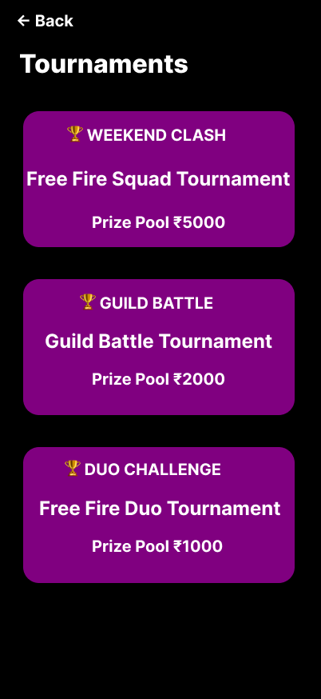
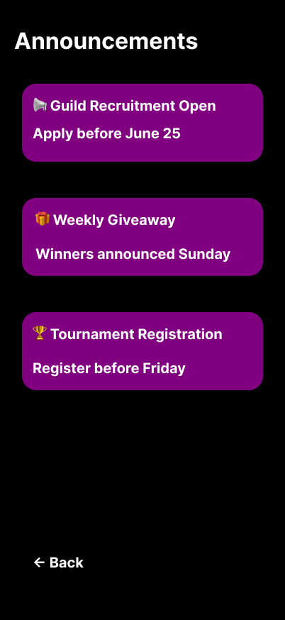
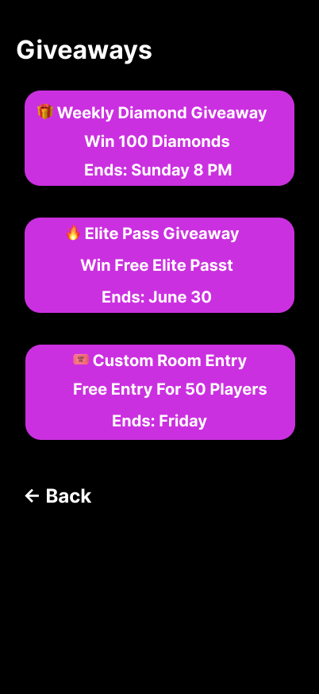

# GWS Connect — UI/UX Design 🎮

## About the Project

GWS Connect is a beginner UI/UX design concept for a Free Fire gaming community platform. Inspired by my interest in gaming and online communities, this project explores ideas for a more connected gaming experience.

## Project Goals

- Explore gaming community interface design
- Practice screen layout and visual hierarchy
- Learn UI/UX design through hands-on practice
- Create a clickable prototype in Figma

## Tools

- Figma
- UI/UX Design Fundamentals

## Figma Prototype

[View the GWS Connect Design](https://www.figma.com/design/RWP3I8qsNtlS4SCjluP3yU/Proj-1---GWS-Connect-%E2%80%93-Free-Fire-Community-Platform?t=0fAICFAoRjPG5TmM-1) 

## Design Screens

### 1. Splash Screen

### 2. Home Dashboard

### 3. Live Stream Details

### 4. Tournaments

### 5. Guild Members

### 6. Announcements

### 7. Giveaways

### 8. Creator Profile

## Project Status

Beginner project — initial UI screens and clickable prototype created. The design may be improved as I continue learning UI/UX.

## About Me

**Surya Dev** — CSE (AI & ML) student exploring UI/UX design and digital experiences.

Also the creator of **Gaming With Surya**, a gaming content brand.
